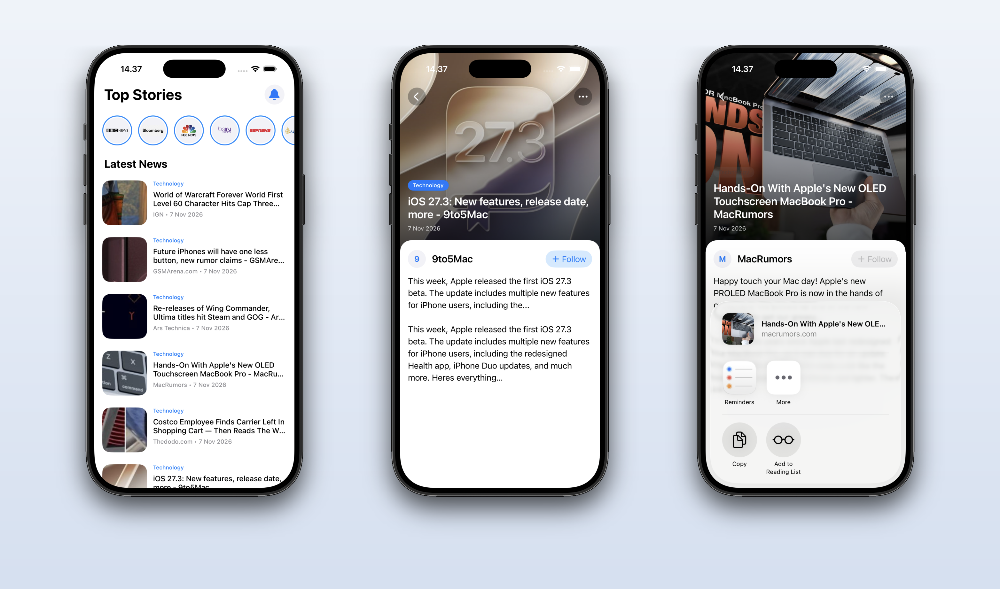

# News App

A simple news app using NewsAPI. Browse the latest technology headlines, then tap an article to read the details and share it.

## Tech stack

- Swift + UIKit
- MVVM + Clean Architecture
- URLSession with async/await
- UICollectionView and UITableView with custom cells
- Pull to refresh and share sheet
- Image caching
- NewsAPI

## Screenshot

  

## Setup

1. Register at [newsapi.org](https://newsapi.org)
2. Copy your API key from the dashboard
3. Create `SecretKey.swift` in `Data/Network` and insert your key:
